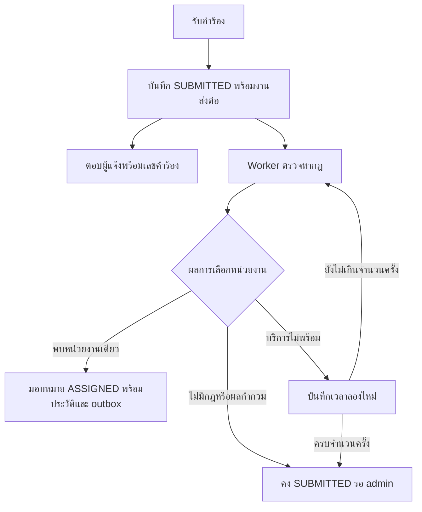

# แผน implement การส่งต่อคำร้องอัตโนมัติ

สถานะ: implement เวอร์ชันตามหมวดแล้ว (8 พฤศจิกายน 2026) — RoutingRule/API, durable worker/retry, manual override, cancel/reject ก่อนเริ่มงาน, หน้าจอกฎและสถานะ พร้อมชุดทดสอบ แผนด้านล่างบันทึกพฤติกรรมและเหตุผลของ implementation; เงื่อนไขอาคารและ AI เป็นระยะถัดไป

เป้าหมายเวอร์ชันแรก: ผู้แจ้งเลือกหมวดแล้วคำร้องเข้าคิวหน่วยงานได้เอง ส่วน admin จัดการเรื่องที่ไม่มีกฎ ส่งต่อไม่สำเร็จ หรือจำเป็นต้องแก้หน่วยงาน

## 1. ขอบเขตและการตัดสินใจ

- เริ่มจากกฎตามหมวด เก็บในฐานข้อมูลของ Department Service และให้ admin แก้ได้
- ใช้หน่วยงานที่มีอยู่ผ่าน `departmentId` ไม่ผูกเงื่อนไขกับชื่อหน่วยงานหรือ UUID ที่เขียนตายตัวในโค้ด
- ประมวลผลการส่งต่อด้วย worker ใน Ticket Service หลังบันทึกคำร้องสำเร็จ เพื่อให้ยังรับเรื่องได้เมื่อ Department Service ไม่พร้อม
- ใช้สถานะคำร้องเดิม `SUBMITTED → ASSIGNED → IN_PROGRESS → RESOLVED → CLOSED` โดยแยกสถานะการลองส่งต่อออกจากสถานะงาน
- บันทึกการมอบหมาย ประวัติ และ outbox ใน transaction เดียวกันตามกลไกที่ระบบมีอยู่
- ข้อเสนอด้านสิทธิ์: reporter ยกเลิกและ admin ปฏิเสธได้ทั้ง `SUBMITTED` และ `ASSIGNED` จนกว่าเจ้าหน้าที่เริ่มงาน เพื่อรองรับการมอบหมายอัตโนมัติที่เกิดเร็วขึ้น ส่วน guest คงสิทธิ์เดิม
- เพิ่มเงื่อนไขอาคารในระยะถัดไปเมื่อมีขอบเขตรับผิดชอบจริงและข้อมูลอาคารที่เป็นโครงสร้าง

กฎเริ่มต้นสำหรับ demo เท่านั้น ต้องปรับให้ตรงกับความรับผิดชอบจริงก่อนใช้งาน:

| category ที่ API ใช้ | หน่วยงานตัวอย่าง |
| --- | --- |
| `IT / Network` | ฝ่ายเทคโนโลยีสารสนเทศ |
| `Electrical` | งานอาคารและสถานที่ |
| `Plumbing` | งานอาคารและสถานที่ |
| `Air conditioning` | งานอาคารและสถานที่ |
| `Building` | งานอาคารและสถานที่ |
| `Other` หรือหมวดที่ไม่รู้จัก | รอ admin ตรวจสอบ |

## 2. พฤติกรรมที่ต้องได้

- `POST /tickets` ยังคงตอบ `201` พร้อมคำร้องที่บันทึกแล้ว การส่งต่ออาจยังอยู่ระหว่างดำเนินการเมื่อได้รับ response
- เมื่อพบกฎ ใช้หน่วยงานและอีเมลจาก Department Service ในผลการ match แล้วมอบหมายผ่าน business transaction ของ Ticket Service
- หากไม่มีกฎ คงสถานะ `SUBMITTED` พร้อมเหตุผล `NO_RULE`; ไม่วนลองซ้ำทุก tick
- หากได้ผลกำกวม คงสถานะ `SUBMITTED` พร้อมเหตุผล `AMBIGUOUS_RULES`; ไม่เลือกหน่วยงานแรกในรายการ
- หาก timeout, network error หรือ HTTP 5xx ให้ลองใหม่โดยเก็บงานใน PostgreSQL จึงทำต่อได้หลัง restart
- หาก admin มอบหมาย ยกเลิก ปฏิเสธ หรือเปลี่ยนข้อมูลระหว่าง worker ทำงาน ผลลัพธ์จากข้อมูลเก่าต้องใช้ไม่ได้
- การแก้กฎมีผลกับการประเมินครั้งถัดไป ไม่ย้ายคำร้องที่มอบหมายแล้ว และไม่ประมวลผลคำร้องเก่าย้อนหลังอัตโนมัติ

## 3. ข้อมูลและ API

**Department Service: เพิ่ม `RoutingRule`**

| ฟิลด์ | การใช้งาน |
| --- | --- |
| `id` | UUID ของกฎ |
| `category` | ค่ามาตรฐานของหมวดที่อนุญาตให้ส่งต่ออัตโนมัติ |
| `departmentId` | FK ไปยังหน่วยงานในฐานข้อมูลเดียวกัน |
| `enabled` | เปิดหรือปิดกฎ |
| `createdAt`, `updatedAt` | เวลาสร้างและแก้ไข |

- Normalize หมวดด้วย trim และเทียบแบบไม่สนตัวพิมพ์ แล้วเก็บเป็นค่ามาตรฐานที่ frontend ใช้อยู่
- จำกัดให้หมวดหนึ่งมีกฎที่เปิดใช้งานได้หนึ่งกฎด้วย database constraint/index; แปลง conflict เป็น HTTP 409 รวมถึงกรณี admin บันทึกพร้อมกัน
- เวอร์ชันแรกไม่สร้างกฎสำหรับ `Other`; หมวดคำร้องเดิมที่เป็นข้อความอิสระยังรับได้ แต่เข้าคิว admin หากไม่มี mapping
- ไม่อนุญาตให้ลบหน่วยงานขณะที่มีกฎเปิดใช้ชี้อยู่ ให้ปิดหรือเปลี่ยนปลายทางของกฎก่อน และเก็บชื่อหน่วยงาน/รายละเอียดกฎในประวัติคำร้องเป็น snapshot

API ที่เสนอ:

| Endpoint | หน้าที่ |
| --- | --- |
| `GET /routing-rules` | รายการกฎสำหรับ admin |
| `POST /routing-rules` | สร้างกฎ |
| `PUT /routing-rules/:id` | เปลี่ยนหน่วยงานหรือเปิด/ปิดกฎ |
| `POST /routing-rules/match` | รับ category และคืน `MATCHED`, `NO_RULE` หรือ `AMBIGUOUS_RULES` |

ผล `MATCHED` ประกอบด้วย rule ID, category และ department ID/name/contactEmail ใน snapshot เดียวกัน Gateway เปิด API กลุ่มนี้ให้เฉพาะ `ADMIN`; worker เรียก Department Service โดยตรงภายใน network เดิม

**Ticket Service: เพิ่ม `TicketRoutingJob`**

เก็บเป็นตารางงานขนาดเล็กในฐานข้อมูล ticket เพื่อให้ retry และ restart ได้ โดยกำหนด `ticketId` เป็น unique key:

- `ticketId`, `state`: `PENDING | PROCESSING | RETRY | REVIEW | DONE | STOPPED`
- `attempts`, `nextAttemptAt`, `lastReason`
- `leaseUntil`, `leaseToken`: ใช้จองงานชั่วคราวและกัน worker ที่ถือผลเก่ากลับมาเขียน
- `requestId`, `createdAt`, `updatedAt`: ใช้ติดตามงานและปัญหา

เพิ่มข้อมูลบน `Ticket`:

- `assignmentSource`: ค่าว่างสำหรับข้อมูลเดิม, `AUTO` หรือ `ADMIN`
- `routingRuleId`: กฎที่ใช้มอบหมายอัตโนมัติครั้งล่าสุด; ล้างเมื่อ admin เปลี่ยนหน่วยงาน โดยประวัติเดิมยังอยู่
- `departmentContactEmail`: snapshot ภายในสำหรับแจ้งหน่วยงานเมื่อมีการยกเลิกหรือปฏิเสธ; ไม่ส่งออกใน public response

เพิ่มฟิลด์ใน response ของ Ticket และ `proto/ticket.proto` โดยใช้ field number ใหม่ต่อท้าย:

- `assignmentSource`, `routingRuleId`
- `routingStatus`: `NONE | PENDING | RETRY | REVIEW | DONE | STOPPED`
- `routingReason`: รหัสเหตุผลที่ frontend แปลงเป็นข้อความไทย

ให้ response mapper อ่านสถานะจาก routing job ซึ่งเป็นแหล่งข้อมูลเดียวของการ retry; ไม่คัดลอก state/attempts ซ้ำลง Ticket และไม่เผย lease, stack trace หรือรายละเอียดระบบภายในแก่ผู้แจ้ง

## 4. Worker, transaction และการลองใหม่

สร้าง `AutoRoutingService` เป็น provider แยกจากรอบส่ง outbox ของ `BackgroundService` เพื่อให้การส่งต่อที่ช้าไม่ขวางการแจ้งเตือนและ analytics

1. เมื่อเปิดฟีเจอร์ การสร้าง Ticket, history, outbox และ routing job ต้อง commit พร้อมกัน หาก transaction ล้มเหลวต้องไม่เหลืองานส่งต่อโดด ๆ
2. Worker เริ่มตรวจเมื่อ service start และทุก 2 วินาที เลือกงานถึงกำหนดแบบ batch จำกัดจำนวนและ claim ด้วย transaction สั้น ๆ / `SKIP LOCKED`
3. Claim งานพร้อม snapshot ของ ticket version/category และออก lease token; เรียก HTTP หลังปล่อย database lock แล้ว
4. ก่อนมอบหมาย ตรวจซ้ำภายใน transaction ว่า lease token ยังตรง, version/category ไม่เปลี่ยน และ ticket ยัง `SUBMITTED`
5. Commit Ticket `ASSIGNED`, assignment source/rule, history, outbox และ job `DONE` พร้อมกัน
6. ถ้าเงื่อนไขไม่ตรง ให้ทิ้งผลเก่า การมอบหมายโดย admin และสถานะที่ปิดงานต้องมีลำดับเหนือ worker
7. หาก service ตายขณะถือ lease งานต้องกลับมาถูก claim ได้เมื่อ lease หมด; ตั้ง lease ยาวกว่า HTTP timeout และตรวจ token เมื่อจะ commit

ค่าเริ่มต้นที่เสนอ: HTTP timeout 3 วินาทีตาม Department timeout เดิม, พยายามรวมไม่เกิน 5 ครั้ง โดยเว้น 5, 15, 60 และ 180 วินาทีระหว่างครั้ง เมื่อครบให้ job เป็น `REVIEW` พร้อมเหตุผล `RETRIES_EXHAUSTED`

- ลองใหม่เฉพาะความผิดพลาดชั่วคราว ไม่ retry หมวดไม่มีกฎหรือข้อมูลปลายทางไม่ถูกต้อง
- เมื่อ job เป็น `REVIEW` admin ยังมอบหมายด้วย API เดิมได้ และมีปุ่ม “ลองส่งต่ออัตโนมัติอีกครั้ง” เฉพาะ `SUBMITTED`
- เพิ่ม RPC `RetryRouting` และ `POST /tickets/:id/retry-routing` สำหรับ admin โดย reset job ใน transaction และไม่สร้าง job ซ้ำ
- การ retry ของ worker ต้องไม่เพิ่มประวัติและส่งอีเมลซ้ำทุกครั้ง; เขียนประวัติเมื่อมอบหมายสำเร็จ เข้าคิวตรวจสอบ หรือ admin สั่งลองใหม่
- การมอบหมายธุรกิจเกิดได้ครั้งเดียวต่อผลการประมวลผล ส่วน broker ยังเป็น at-least-once ตามระบบเดิมและใช้ event ID กันบันทึก notification ซ้ำ

## 5. ผลกับ action เดิมและหน้าจอ

**Action เดิม**

- Manual assign/re-route: ตั้ง source เป็น `ADMIN`, ยกเลิก lease และจบ routing job ใน transaction เดียวกัน
- Recategorize ตอน `SUBMITTED`: invalidate ผลเก่าและเริ่มประเมินใหม่เมื่อเปิด auto-routing
- Recategorize ตอน `ASSIGNED`: บันทึกหมวดใหม่; ให้ admin เป็นผู้ตัดสินใจ re-route เพื่อไม่ย้ายงานที่คนจัดการแล้วโดยเงียบ ๆ
- Cancel/reject: ตามข้อเสนอในแผน อนุญาต `SUBMITTED` และ `ASSIGNED`; ห้ามตั้งแต่ `IN_PROGRESS` เป็นต้นไป และเปลี่ยน job เป็น `STOPPED`
- แข่งกันระหว่าง start กับ cancel/reject: ใช้ version check และ row lock เดิม ให้สำเร็จได้ action เดียว อีก action รับ HTTP 409
- Cancel/reject หลังมอบหมาย: แจ้งหน่วยงานผ่าน contactEmail snapshot โดยไม่ต้องรอ Department Service; reject ยังคงแจ้ง reporter ด้วย
- หากเหตุการณ์เดียวมีผู้รับหลายคน ให้เขียน notification outbox แยกผู้รับพร้อม event ID ที่ไม่ซ้ำ และส่ง analytics สำหรับ business transition เพียงครั้งเดียว
- Guest คงสิทธิ์เดิม: ส่งเรื่องและติดตามของตนเองได้ แต่ไม่เพิ่มสิทธิ์ cancel/confirm/reopen จากฟีเจอร์นี้

**หน้าจอ**

- หน้า `/admin/departments`: เพิ่มส่วน “กฎส่งต่ออัตโนมัติ” ให้เลือกหน่วยงานต่อหมวดและเปิด/ปิดกฎ ใช้รูปแบบฟอร์มเดิมพร้อม label/error ที่ชัดเจน
- หน้า admin inbox: แยกจำนวน “รอระบบส่งต่อ” กับ “ต้องตรวจสอบ” ภายใต้คำร้อง `SUBMITTED` เพื่อไม่ให้เรื่องที่ยังประมวลผลดูเป็นเรื่องที่ระบบตัดสินไม่ได้
- หน้า review: แสดงเหตุผลที่รอ admin, แหล่งการมอบหมาย, กฎที่ใช้ และปุ่มลองใหม่; manual assignment ยังใช้ได้ขณะรอระบบ
- หน้า reporter/success: เปลี่ยนข้อความจากรอ admin เป็น “ได้รับเรื่องแล้ว กำลังส่งต่อ” หรือแสดงหน่วยงานตามข้อมูลล่าสุด
- ระหว่าง `PENDING/RETRY` ให้ detail page ตรวจข้อมูลซ้ำทุก 3 วินาที หยุดเมื่อออกจากสถานะรอหรือออกจากหน้า และป้องกัน request ซ้อน
- Timeline: แสดง “ระบบมอบหมายอัตโนมัติ” พร้อมเหตุผลที่อ่านได้ แยกจากการมอบหมายโดย admin
- ปรับปุ่มและคำอธิบาย cancel/reject ให้ตรงกับเงื่อนไขก่อนเริ่มงาน รวมถึงข้อความบนหน้า public และเอกสารที่ยังอธิบายว่า admin มอบหมายทุกเรื่อง
- กฎจาก backend เป็นข้อมูลสำหรับตัดสินใจ หน้า frontend ไม่เรียก assign เองหลังส่งคำร้อง และคำแนะนำอาคารเดิมต้องไม่ถูกแสดงเสมือนเป็นกฎส่งต่อ

## 6. ลำดับ implement และไฟล์หลัก

| ชุดงาน | รายการ | ไฟล์หลักที่จะเพิ่ม/แก้ |
| --- | --- | --- |
| 1. กฎและ API | RoutingRule, validation, constraint, CRUD/match, role checks | `services/department-service/src/routing-rule.entity.ts`, `routing-rules.dto.ts`, `routing-rules.service.ts`, `routing-rules.controller.ts`, `app.module.ts`; gateway controller/module |
| 2. ส่งต่อและ recovery | routing job, worker, atomic create/assign, lease/retry, manual override | `services/ticket-service/src/ticket-routing-job.entity.ts`, `auto-routing.service.ts`, `ticket.entity.ts`, `tickets.service.ts`, `app.module.ts` |
| 3. Contract และ lifecycle | response mapper, retry RPC, cancel/reject, multi-recipient outbox | `proto/ticket.proto`, ticket/gateway `tickets.controller.ts`, ticket response mapper และ helper ของ outbox |
| 4. หน้าจอ | จัดการกฎ, แสดงผลการส่งต่อ, polling, timeline, action ใหม่ | `frontend/src/lib/api.ts`, `frontend/src/lib/format.ts`, `frontend/src/pages/admin.tsx`, `reporter.tsx`, `public.tsx` |
| 5. Demo และเปิดใช้ | seed กฎ, feature flag, schema setup, เอกสารและ tests | `scripts/seed-demo.mjs`, `.env.example`, `docker-compose.yml`, `tests/*`, `README.md` |

แต่ละชุดต้องมี tests ที่เกี่ยวข้องก่อนเชื่อมชุดถัดไป จุดตรวจแรกคือสร้างกฎ IT → ส่งคำร้อง → worker มอบหมาย → staff เห็นในคิว โดยไม่กด assign และตามด้วยกรณีไม่มี rule/service outage ก่อนเพิ่ม UI จัดการกฎเต็มรูปแบบ

## 7. การตรวจรับ

| กรณี | ผลที่คาดหวัง |
| --- | --- |
| หมวด IT และมีกฎเปิดใช้ | เปลี่ยนเป็น `ASSIGNED`, source `AUTO`, ถูกหน่วยงาน และ staff หน่วยงานอื่นเข้าไม่ถึง |
| `Other`, หมวดไม่รู้จัก หรือกฎปิดใช้ | คง `SUBMITTED`, job `REVIEW`, admin เห็นเหตุผล |
| บันทึกกฎ active ซ้ำ / บันทึกพร้อมกัน | HTTP 409 และเหลือ active rule เดียว |
| ผู้ใช้ที่ไม่ใช่ admin เรียก API กฎ/retry | HTTP 403 |
| Department Service ล่ม | ยังรับคำร้องได้และเก็บ retry; เมื่อกลับมาระหว่างช่วง retry ให้มอบหมายได้ |
| ล่มจนพยายามครบ | หยุด retry และเข้าคิว admin; สั่ง retry ภายหลังได้ |
| Ticket Service restart กลางงาน | งานไม่สูญหายและกลับมาทำต่อเมื่อ lease หมด |
| Worker สองตัวหรือผล HTTP เก่ากลับมาช้า | เกิด assignment/history/outbox ชุดเดียว; ผลที่ lease หมดใช้ไม่ได้ |
| Admin assign/cancel/reject ระหว่าง worker รอ | Worker ไม่เขียนทับผลของ admin หรือทำให้เรื่องกลับมาเปิด |
| เปลี่ยนหมวดระหว่างประมวลผล | ผลจากหมวดเก่าใช้ไม่ได้ |
| Cancel/reject หลัง auto-assign แต่ก่อน start | สำเร็จและแจ้งผู้เกี่ยวข้อง; start ภายหลังไม่ได้ |
| Staff start แข่งกับ cancel/reject | สำเร็จได้รายการเดียว อีก action ได้ 409 |
| RabbitMQ ล่มขณะมอบหมาย | assignment และ outbox ยัง commit; ส่ง notification/analytics ต่อเมื่อ broker กลับมา |
| Browser refresh หรือปิดหน้า | การส่งต่อยังทำงานที่ backend และเปิดกลับมาดูผลได้ |
| ปิด feature flag | คำร้องใหม่เดิน flow manual; ข้อมูลที่มอบหมายแล้วคงอยู่ |

เพิ่ม unit tests ของการ normalize/match และ integration tests ที่ใช้ PostgreSQL จริงสำหรับ transaction, constraint, lease และ concurrency; ใช้ HTTP stub ที่ควบคุมเวลาตอบได้สำหรับ outage/timeout/stale response

คำสั่งตรวจหลักหลัง implement: `npm run typecheck`, `npm test`, `npm run test:e2e`, `npm run test:ui`, `npm run test:recovery` และเพิ่ม recovery scenario สำหรับ Department Service แยกจาก broker outage เดิม

ปรับ fixtures ของ e2e ให้สร้างกฎเฉพาะ scenario, รอผลผ่าน polling แบบมี deadline และ cleanup กฎหลังจบ เพื่อไม่ให้ seed demo หรือสถานะเริ่มต้นแบบ manual ทำให้ tests ผ่าน/ตกโดยบังเอิญ

## 8. Schema, การเปิดใช้ และระยะถัดไป

- ปัจจุบัน TypeORM ใช้ `synchronize: true`; สำหรับ local/demo เพิ่ม entity/columns และตรวจการเริ่มระบบด้วยฐานข้อมูลที่มีข้อมูลเดิม
- ตั้งค่า default แบบย้อนหลังปลอดภัย: Ticket เดิมมี assignment source ว่าง และไม่มี routing job; ไม่ตีความว่าทั้งหมดถูก admin มอบหมายและไม่ส่งต่อเรื่องเก่าเอง
- หากมีการ deploy ที่ต้องคุม schema ให้เพิ่ม migration แบบ additive ก่อนเปิด worker และทดสอบกับสำเนาข้อมูลเดิม; ไม่ drop/recreate ตาราง
- เพิ่ม `AUTO_ROUTING_ENABLED` ค่าเริ่มต้น `false` และตรวจว่าค่า env ส่งถึง container จริง เปิดเมื่อ schema/API/worker พร้อมและตั้งกฎแล้ว
- Seed demo หาหน่วยงานผ่าน API ตามชื่อเพื่อสร้าง mapping ไปยัง ID จริง; seed ซ้ำต้องไม่สร้างกฎซ้ำหรือเขียนทับกฎที่ admin แก้เอง
- การปิดฟีเจอร์หยุด enqueue/claim งานใหม่ งานที่รอเก็บไว้ในฐานข้อมูลและ admin ยังมอบหมายเองได้ ส่วน assignment ที่ commit แล้วไม่ถูกย้อนกลับ
- เก็บ log ของ ticket ID, rule ID, attempt และผลการส่งต่อ พร้อมดูจำนวนงาน pending/retry/review เพื่อหากฎที่ขาดหรือบริการที่มีปัญหา
- เมื่อ feature พร้อม อัปเดต use case/sequence diagram เดิมให้แสดง worker และ manual fallback

ระยะถัดไป: เพิ่ม `buildingId` ที่อ้างอิงข้อมูลอาคารจริงแทนการตัดสินใจจาก substring ของ `location`; ขยาย rule เป็นหมวด + อาคาร โดยกฎเฉพาะอาคารมาก่อนกฎหมวดทั่วไป หากกฎที่มีลำดับเท่ากันชี้คนละหน่วยงานให้เข้าคิว admin จากนั้นจึงพิจารณา AI โดยใช้ข้อมูลการแก้หมวด/หน่วยงานจริงวัดประโยชน์และความแม่นยำ
