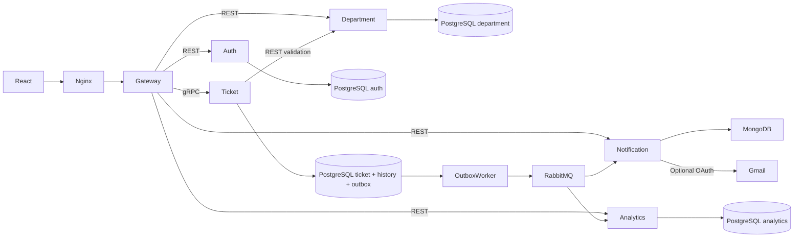

# Complete platform implementation

This implementation extends the [Progress 3 ADR](https://docs.google.com/document/d/1MopMzS8NnrUh-T-uzJdwtnYgIHmHdve4kHswLa8M5xs/edit) and [microservice design](https://docs.google.com/document/d/1tV8zv5oeoKWz8f1YygZSBNOv1eupXF-WQGvgB0MN76I/edit). Historical milestone documents describe the older five-service prototype.

| Use case | Implementation | UI |
| --- | --- | --- |
| UC-01 Report | Signed-in Reporter; 1–5 JPEG/PNG/WebP, 5 MB each; retry-safe submission keys | `/report` |
| UC-02 Route | Automatic category rules with durable retry; admin fallback, rerouting, recategorization, rejection before work starts | `/admin`, `/admin/departments` |
| UC-03 Resolve | Staff department scope; start then resolve with proof | `/staff` |
| UC-04 Track | Owner list/history; original-session tracking for legacy guest tickets | `/my`, `/track` |
| UC-05 Notify | Outbox → RabbitMQ → MongoDB; optional Gmail worker | `/notifications` |
| UC-06 Confirm/reopen | Owner confirmation/reason; 7-day auto-closure | `/tickets/:id` |
| UC-07 Analytics | Own database/projection; date/category/department filters; MTTR/hotspots | `/admin/analytics` |
| UC-08 Departments | Admin CRUD/retirement guards; account lifecycle and immediate token revocation | `/admin/departments`, `/admin/users`, `/account` |

## Reliability and ownership

The [10 November hardening update](platform-hardening.md) adds department notification audiences, per-user reads, account recovery/session revocation, department retirement, and idempotent submission. Its behavior supersedes the older guest/submission and stateless-token descriptions where applicable. New guest submissions are rejected; only older guest tickets remain readable with their original token.

Ticket, history and outbox commit in one transaction. Broker failure leaves pending events for retry. Per-queue publication flags and publisher confirms prevent an acknowledged ticket change from silently losing its event. A crash can redeliver an event; notification event IDs and analytics versions deduplicate it. Outbox workers use row locks and SKIP LOCKED. Published outbox rows expire after seven days; ticket history remains.

Ticket version checks prevent concurrent updates from overwriting each other. Gateway passes the version used for its ownership/department check in gRPC metadata; a changed ticket returns HTTP 409. Internal services trust the gateway and are not published outside the Compose network.

Legacy guest reports store the JWT subject. Knowing a UUID or registering the same email does not grant access. Guest tokens last 30 days; clearing browser storage loses that session. New reports require a signed-in Reporter. Registered tokens last one day and can now be revoked through account/password changes. Legacy records without a subject retain the old registered-email access rule. Authentication endpoints have a per-IP 30/minute default limiter; multiple gateway instances require shared rate-limit storage.

Images have server-side signature/count/size checks and persistent storage. URLs use random names but remain bearer links, as in the original design. Do not upload confidential documents. Auto-closure runs every two seconds, closes resolutions older than seven days, and uses the same transaction/version check as user actions.

MTTR uses `(resolvedAt - createdAt)` for currently resolved/closed reports. Reopening clears that timestamp until resolution occurs again. Analytics is eventually consistent. Older pre-upgrade reports need explicit analytics import/backfill; only new events populate the projection.

## Gmail

Default `EMAIL_MODE=record` sends nothing. For real delivery enable Gmail API, obtain OAuth consent with `gmail.send`, and set `GMAIL_CLIENT_ID`, `GMAIL_CLIENT_SECRET`, `GMAIL_REFRESH_TOKEN`, `GMAIL_FROM`, and `EMAIL_MODE=gmail`. Recreate notification-service with the same env file.

The worker uses [users.messages.send](https://developers.google.com/workspace/gmail/api/reference/rest/v1/users.messages/send) and [OAuth refresh tokens](https://developers.google.com/identity/protocols/oauth2/web-server#offline). It stores SENT/RETRY/FAILED, retries up to five times with backoff, and recovers expired send leases. A crash after Gmail accepts a message but before MongoDB records SENT can duplicate an email; external delivery is not exactly-once. Unit tests mock Gmail HTTP; real account delivery requires user credentials and a live verification run.

## Deployment boundaries

This is a single-host course deployment. HTTPS, multi-host discovery, backups, shared rate limits and production schema migrations are deployment work. TypeORM uses `synchronize: true` for the local demo. Do not connect a production database without reviewed migrations. Old NFR evidence does not establish new performance or 99.5% term-long uptime. The current verification scripts create fresh fixtures and save evidence in `test-results/`.

The MongoDB container requires a compatible host kernel. MongoDB documents a [kernel 6.19–7.0.13 incompatibility](https://www.mongodb.com/docs/manual/administration/production-notes/). CI uses the Ubuntu 22.04 runner because newer hosted images encountered this startup guard. The Windows Docker Desktop environment used for local verification starts the MongoDB container successfully.
