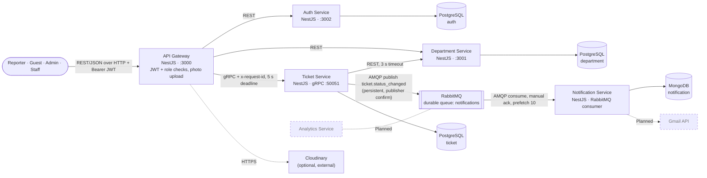
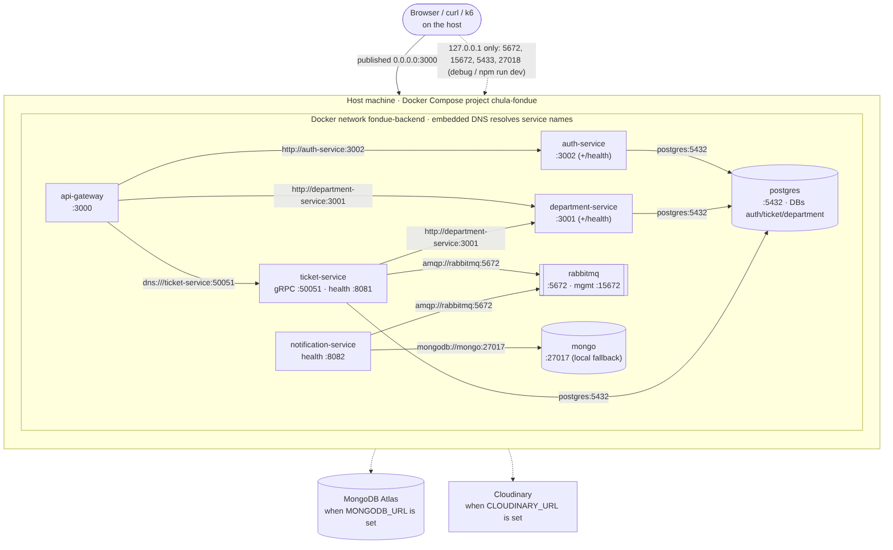
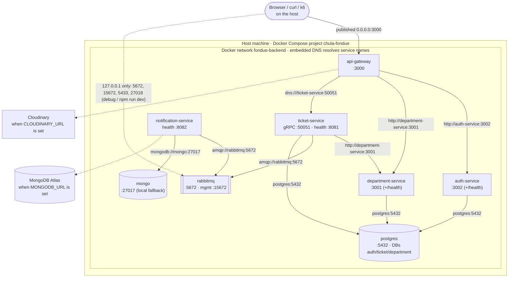
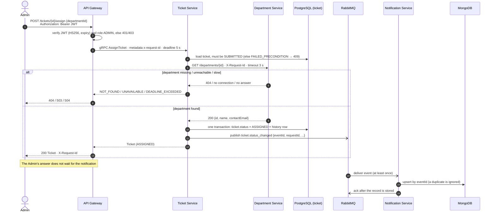
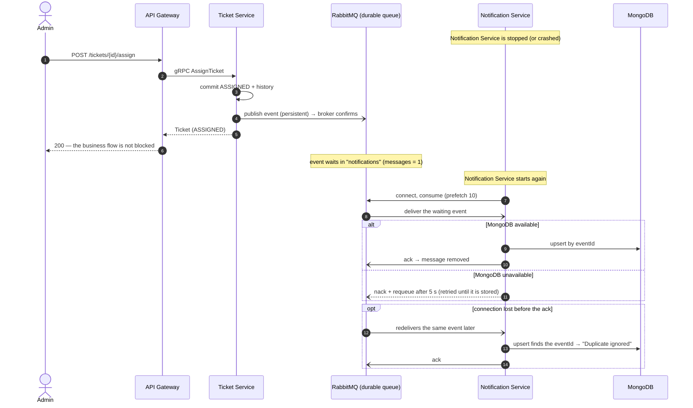

# Progress 3: Diagrams

Sources are the `.mmd` files in [diagrams/](diagrams/). GitHub renders the blocks below, and the PNGs in the same folder are ready to paste into the Google Docs. To re-render after editing: `npx -p @mermaid-js/mermaid-cli mmdc -i diagrams/<file>.mmd -o diagrams/<file>.png -b white -s 2`.

Dashed boxes and lines are **Planned**: they are not built in this round.

## 1. System / container diagram

Mermaid source

## 2. Deployment diagram (Docker Compose)

Mermaid source

## 3. Sequence: Assign Ticket

Mermaid source

## 4. Sequence: Failure and recovery of Notification Service

Mermaid source

