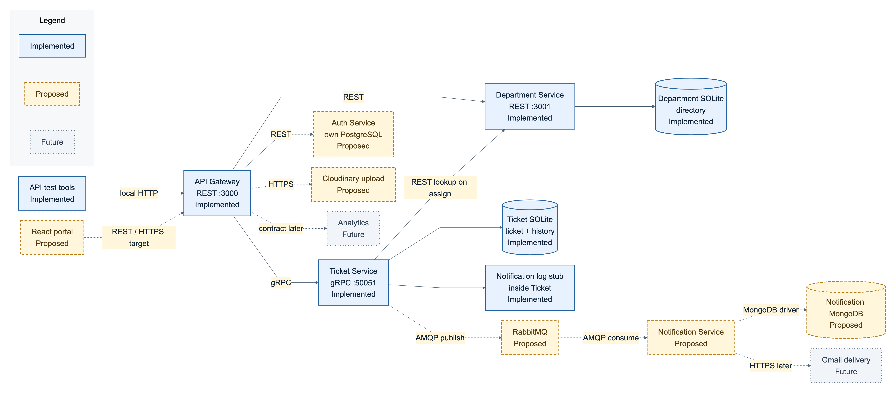
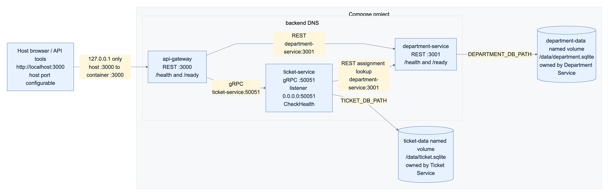
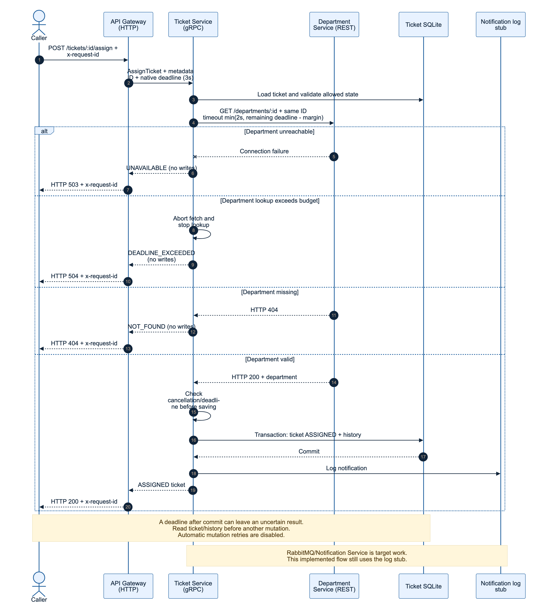

# Chula Fondue

**Project proposal and weekly progress report**

Revised microservice design, architecture decisions and measured NFR evidence

**Version:** 1.0 | **Date:** 27 October 2026 | **Scope:** local backend progress

## Executive summary

Chula Fondue provides a central place to report campus maintenance issues, route them to a responsible department and track repair progress. This revision preserves the original actors, eight use cases and product requirements [R1-R2], while documenting what the repository can actually demonstrate today.

Three NestJS services now run through Docker Compose: a REST API Gateway, a REST Department Service and a gRPC Ticket Service. They support department CRUD, ticket lifecycle/history, service-name discovery, persistent SQLite volumes, application health checks, bounded dependency calls and request correlation.

The latest local benchmark passed the provisional p95/error criteria for both ticket-list and history reads. The complete verification suite is **FAIL**, because a stopped Ticket dependency returned HTTP 504 after about 3 seconds rather than the test's expected 503. That finding remains open. Passing a local read benchmark does not establish the original 1,000-user or 99.5%-uptime requirements.

React, JWT/RBAC, Cloudinary, PostgreSQL, RabbitMQ and a MongoDB-backed Notification Service remain target work. Gmail, analytics and seven-day automatic closure remain future work. Existing notification logs are a stub, not asynchronous delivery.

## Project team

| Member | Student ID |
| --- | --- |
| Kotchapan Lertpanyaroj | 6630001321 |
| Chavapon Suwanna | 6630055221 |
| Natamathee Polerdsawat | 6630092421 |
| Piyapanchanok Meeboonsalang | 6630196021 |
| Pitchanan Thaiphayak | 6632151121 |

This document contains the problem and use cases, service/data boundaries, three rendered architecture views, discovery/resilience decisions, NFR targets and results, remaining work, and all eleven ADRs. The companion video is a separate deliverable owned by Person 5; it is not completed by this report.

<!-- pagebreak -->

## 1 Problem and scope

Chulalongkorn University's buildings, faculties and public spaces experience broken air conditioners, damaged walkways, overflowing bins and failed lighting. Reports can reach unclear channels, be lost, or receive no visible follow-up. A central reporting and routing workflow makes responsibility and progress visible without requiring the reporter to know which office owns the location.

### Actors and intended permissions

| Actor | Intended responsibilities | Current enforcement |
| --- | --- | --- |
| Reporter: student, staff or visitor | Submit issues, track own reports, cancel SUBMITTED, confirm or reopen RESOLVED | Workflow endpoints exist; identity/ownership enforcement absent |
| Central Admin | Review/categorize, assign/reassign or reject tickets; manage departments; view metrics | Routing/rejection/department APIs exist; category editing, admin guards and dashboards absent |
| Department Staff | View own queue, start work, record completion and resolve | Department filter and transitions exist; department authorization absent |

Actors describe the product's requirements, not authenticated roles in today's prototype. Email and department fields supplied by callers are data, not proof of identity.

### Progress boundary

| Label | Meaning in this report | Examples |
| --- | --- | --- |
| Implemented | Runnable code exists; verification result stated separately | Three services, SQLite, DNS, deadlines, request IDs |
| Proposed | Target design or integration not yet delivered | React, Auth/JWT/RBAC, Cloudinary, PostgreSQL, RabbitMQ, Notification/MongoDB |
| Future | Explicitly deferred beyond the next integration scope | Gmail delivery, analytics, seven-day auto-closure |

Decision status is separate: original ADR-001 to ADR-008 remain Accepted as recorded in the source proposal. New ADR-009 to ADR-011 are Proposed pending team ratification, even though their local mechanisms already exist.

### Functional requirements retained

The product requires registered and restricted guest access; a primarily Thai responsive mobile-browser portal without native app installation; category, building/faculty location and description; up to five photos of at most 5 MB each; admin categorization and manual routing/re-routing; department CRUD; seven ticket statuses and their history; department queues; asynchronous notification records; reporter confirmation/reopening; and later analytics/auto-closure. Current API support covers only part of that end-to-end experience. No UI, upload or authentication completion is claimed.

<!-- pagebreak -->

## 2 Use cases for reporting and repair

### UC-01 Report campus issue

**Actor:** Reporter. **Trigger:** a campus maintenance issue. **Target precondition:** registered or restricted guest session. The reporter enters category, location and description, and supplies a contact email for guest access. Gateway validates up to five images, each at most 5 MB, uploads them to Cloudinary, then Ticket Service stores the report and image URLs. **Postcondition:** a new SUBMITTED ticket awaits review. Invalid required fields or media are rejected; cancellation while SUBMITTED changes the ticket to CANCELLED and removes it from the normal inbox.

**Implemented:** API creation validates required text fields, records history, and supports SUBMITTED cancellation. **Proposed:** portal, identity/guest restrictions, image count/size validation and uploads. The current model stores one photoUrl string; it does not implement the required multi-photo feature.

### UC-02 Route ticket to department

**Actor:** Central Admin. **Target precondition:** authenticated admin and a SUBMITTED ticket; reassignment is allowed while ASSIGNED. The admin reviews details and selects a department maintained through UC-08. Ticket Service looks up that department, then atomically saves ASSIGNED and its history. **Postcondition:** the department queue can list the assigned ticket. An unknown department is rejected without changing ticket/history. Invalid or duplicate reports may be rejected with a reason. The target also publishes a TicketAssigned notification event for UC-05 after a successful transition.

**Implemented:** assignment/reassignment APIs, REST lookup, transactional history and rejection. **Proposed:** protected dashboard and RabbitMQ publishing. A failed Department lookup before commit leaves the ticket unchanged; assignment notification is currently a local log stub.

### UC-03 Resolve ticket

**Actor:** Department Staff. **Target precondition:** a ticket assigned to that staff member's department. Staff changes ASSIGNED to IN_PROGRESS, performs repairs, supplies completion proof and resolves the ticket. **Postcondition:** status RESOLVED with reviewable proof; target status events feed UC-05.

**Implemented:** ASSIGNED to IN_PROGRESS to RESOLVED, with transaction/history. The current resolve RPC accepts a completionPhotoUrl and stores it in a history note. **Proposed:** staff permissions, photo upload, structured multi-photo completion storage and notification events. The API requires starting progress before resolving.

### UC-04 View ticket status and history

**Actor:** Reporter. **Precondition:** ticket exists; target access must respect ownership. The reporter lists reports, filters them and opens a status timeline. **Postcondition:** current state and ordered history are available; unknown IDs return 404.

**Implemented:** list/history APIs and status, departmentId, reporterEmail and includeCancelled filters. **Proposed:** My Tickets UI, ownership enforcement and media display. The current reporterEmail filter is not an access-control mechanism.

<!-- pagebreak -->

## 3 Supporting and future use cases

### UC-05 Record ticket notification

**Actor:** system-triggered; RabbitMQ is supporting infrastructure. **Precondition:** a qualifying committed ticket transition and intended recipient. Assignment, start/reopen, resolve, reject and confirmation/closure can produce the corresponding notification event. This reconciles UC-02/03/06 and the original operation catalog.

**Target flow:** Ticket Service publishes an event with a stable eventId to RabbitMQ. Notification Service consumes it, creates a notification record in MongoDB, then acknowledges the message. Duplicate eventId values must not create duplicate records. **Postcondition:** the record is stored and the message acknowledged. Relationships are Ticket Service, RabbitMQ and Notification/MongoDB; Gmail is not required for this use case.

If a consumer fails before acknowledgement, delivery may be repeated. If publication fails after the SQL commit, the ticket remains committed and the error is logged. This initial target can lose notifications; a durable outbox/recovery mechanism is future work before a guaranteed-delivery claim. **Current implementation:** a log stub only; RabbitMQ, consumer, MongoDB persistence and deduplication are Proposed. **Future:** Gmail email delivery. The original Gmail relationship/postcondition is superseded by this record-based flow.

### UC-06 Confirm or reopen resolution

**Actor:** Reporter. **Precondition:** a RESOLVED ticket, with target ownership checks. The reporter reviews the repair and confirms it to change RESOLVED to CLOSED, or provides a mandatory reason to return it to IN_PROGRESS. **Postcondition:** confirmed closure or renewed work is recorded in history; target notifications use UC-05.

**Implemented:** confirm/reopen transitions and required reopen reason. **Proposed:** ownership UI/guards and event publication. **Future:** automatic CLOSED transition after seven days without reporter action. No scheduler currently implements it.

### UC-07 Generate analytics report

**Actor:** Central Admin. **Target precondition:** authenticated admin and ticket data. Select dates, department/faculty and category; aggregate resolution times and recurring issue locations. **Postcondition:** MTTR and hotspot views are displayed, or an empty-state message when no data matches. **Status:** Future; there is no Analytics Service or analytics endpoint. Any later analytics design must read owned APIs/events or an explicit read model, not directly query another service's private database.

### UC-08 Manage departments

**Actor:** Central Admin. **Target precondition:** authenticated admin. Create, list, view, update and delete departments, including name, contact email and buildings covered. **Postcondition:** updated department data is available to UC-02. Duplicate names are rejected.

**Implemented:** REST CRUD, DTO validation, unique names and owned SQLite persistence. **Proposed:** admin UI/guards. Department deletion and reassignment policy need further product rules; existing tickets retain the department snapshot stored at assignment.

<!-- pagebreak -->

## 4 Implemented service catalog

Each service is a separate NestJS application. Gateway owns transport/routing concerns; Ticket owns workflow decisions; Department owns the department directory. Runtime configuration and SQLite files are independent.

| Boundary and operations | Protocol | Owned data and dependencies |
| --- | --- | --- |
| API Gateway: REST ticket routes and department forwarding; /health and /ready; error translation and request correlation | HTTP REST :3000; outbound gRPC :50051 and REST :3001 | No business database. Depends on Ticket and Department; serves independent routes during partial failure |
| Ticket Service: CreateTicket, ListTickets, GetTicketHistory, AssignTicket, CancelTicket, RejectTicket, StartProgress, ResolveTicket, ConfirmResolution, ReopenTicket and CheckHealth | gRPC :50051; outbound Department REST lookup on assign | Own Ticket and TicketHistory in /data/ticket.sqlite. NotificationStub is an internal logger, not a service |
| Department Service: create/list/get/update/delete departments; /health and /ready | HTTP REST :3001 | Own Department in /data/department.sqlite: ID, unique name, contactEmail, buildings and timestamps |

### REST and RPC correspondence

| Gateway routes | Ticket RPC |
| --- | --- |
| POST /tickets; GET /tickets | CreateTicket; ListTickets |
| GET /tickets/:id/history | GetTicketHistory |
| POST /tickets/:id/assign; DELETE /tickets/:id | AssignTicket; CancelTicket |
| POST /tickets/:id/reject; /start; /resolve | RejectTicket; StartProgress; ResolveTicket |
| POST /tickets/:id/confirm; /reopen | ConfirmResolution; ReopenTicket |

Department REST uses /departments and /departments/:id through Gateway forwarding. Ticket's CheckHealth is an application-specific unary RPC, not the standard grpc.health.v1 protocol.

### Ticket state and integrity

SUBMITTED permits ASSIGNED, REJECTED or CANCELLED. ASSIGNED permits reassignment or IN_PROGRESS. IN_PROGRESS permits RESOLVED; RESOLVED permits CLOSED or IN_PROGRESS with a reopen reason. CLOSED, REJECTED and CANCELLED have no further workflow transition in this prototype. Normal lists exclude CANCELLED unless includeCancelled=true. Ticket and history are saved in the same local transaction. A pre-commit dependency failure must not create a partial assignment.

<!-- pagebreak -->

## 5 Proposed services and data evolution

| Boundary | Operations and protocol | Owned data and collaborators |
| --- | --- | --- |
| Auth Service - Proposed | Register, Login, GuestLogin and token validation; REST from Gateway | Own PostgreSQL identity/role/guest data. No application or schema exists yet |
| Notification Service - Proposed | HandleTicketStatusChanged from RabbitMQ via AMQP; acknowledge after storage | Own MongoDB notification records with unique eventId. No Gateway-to-Notification RPC |
| React portal - Proposed | Report, review, route, resolve and confirm screens; Gateway REST/HTTPS | UI state only; no direct backend database access |
| Cloudinary integration - Proposed | Gateway validates/uploads images using HTTPS | Media content external; Ticket stores permitted URL metadata |
| Analytics - Future | Authorized aggregate reports/read model; contract not finalized | Own read model if introduced; no direct cross-service table access |
| Gmail delivery - Future | Notification delivery adapter via HTTPS | Provider credentials/consent and delivery policy not specified or implemented |

### Storage ownership and migration

ADR-007 retains PostgreSQL on Render as the original target for Auth, Ticket and Department, and MongoDB for Notification. Each boundary owns its database/schema and credentials. The current two SQLite databases are a prototype deviation documented openly; no cloud database is provisioned by this progress report.

Ticket owns report fields, status, assignment snapshots and history. Department owns contact/building coverage. Cross-service consistency is achieved by validating a department through its API before assignment, not by a cross-database foreign key or shared transaction. A later department edit does not automatically rewrite existing ticket snapshots.

A proposed migration must define explicit PostgreSQL schemas/migrations, export/import SQLite fixtures, reconcile ticket/history counts and IDs, run lifecycle and failure tests in staging, validate backup/restore, and retain a rollback path. Production schema management must replace automatic synchronization. Persistence across recreation proves the selected volume-backed records survive container replacement; it does not prove recovery from disk loss.

### Proposed event contract

Use eventId, eventType, ticketId, recipient, occurredAt and schemaVersion as the initial event envelope to finalize. Candidate events are TicketAssigned, TicketProgressStarted, TicketResolved, TicketRejected, TicketReopened and TicketClosed. These are target contracts, not existing message implementations. SQL commit and AMQP publication are separate; record this delivery gap until a reliable publishing design is delivered.

<!-- landscape -->

## 6 Revised logical architecture

**Figure 1.** Implemented components are blue with solid call paths. Proposed components are amber with dashed call paths; Future components are grey. Status is written in labels as well as encoded by color. SQLite is current; PostgreSQL remains the service-owned relational target. Current local traffic is HTTP/insecure gRPC; HTTPS is a proposed deployment boundary.

<!-- landscape -->

## 7 Local deployment and discovery

**Figure 2.** The host calls Gateway's published loopback port; containers use service-name DNS within the backend bridge network. Only Gateway is published. The two SQLite databases use separate named volumes. Current images include the shared application probe; older images may still use the bootstrap fallback and must be rebuilt for current behavior. This is a single-host local view.

<!-- diagram-portrait -->

## 8 Assignment sequence and failure boundary

**Figure 3.** Implemented Gateway → Ticket → Department flow, including pre-commit failure paths and a local ticket/history transaction. The notification action shown is the current log stub. RabbitMQ publishing/consumption belongs to the proposed flow in Figure 1 and UC-05. A deadline after commit can leave an uncertain caller result; read state before retrying a mutation.

<!-- pagebreak -->

## 9 Discovery and resilience management

Configuration selects logical names and ports. Compose DNS resolves those names within the network; application clients must handle broken connections after replacement. Static IPs are not used. The host cannot use Compose-only names; container localhost addresses the caller itself [R3]. Actual lookup/configuration and reconnect evidence is recorded in discovery.json [E1].

| Environment or caller | Destination |
| --- | --- |
| npm/local development | Gateway localhost:3000; Department localhost:3001; Ticket localhost:50051 |
| Host to Compose | http://localhost:3000 by default; isolated Person 3 run used 31320 |
| Gateway to Ticket in Compose | ticket-service:50051 |
| Gateway/Ticket to Department in Compose | http://department-service:3001 |
| Ticket listener | 0.0.0.0:50051, not a client discovery address |

Local .env values remain unchanged; Compose supplies container-specific URLs. Replacement checks preserve the original Gateway container and database volumes. Both service container IDs changed and reads succeeded without editing URLs. The run does not claim IP addresses changed; Docker can reuse them.

### Health and budgets

| Mechanism | Current behavior |
| --- | --- |
| Liveness | Gateway/Department GET /health answers independently of dependency readiness |
| Readiness | GET /ready checks dependencies/DB; Gateway returns 503 with separate Department/Ticket results when degraded |
| Ticket readiness | CheckHealth returns SERVING or NOT_SERVING and database status |
| Business calls | Gateway→Department REST 2,000ms including body; Gateway→Ticket native gRPC deadline 3,000ms |
| Assignment lookup | At most 2,000ms, shortened to remaining incoming RPC deadline minus a 25ms margin |
| Health checks | Application dependency/DB checks 750ms; shared probe transport budget 2s; Docker wrapper process limit 4s |

Startup service_healthy ordering [R4] does not provide runtime failover, replace an unhealthy service automatically or prove uptime. A Gateway with readiness 503 can still serve independent routes. Deployment routing policy must account for this choice.

UNAVAILABLE maps to 503, DEADLINE_EXCEEDED to 504, invalid input to 400, missing records to 404 and invalid transitions to 409. Cancellation/deadline checks precede writes; no automatic mutation retry, idempotency key or circuit breaker is implemented [R5]. The repeated stopped-Ticket 504 finding is retained in Section 12 rather than relabelled as a pass.

<!-- landscape -->

## 10 NFR matrix for the implemented backend

Original requirements remain intact. The progress benchmark uses a provisional p95 criterion; it does not replace the original 1-second query requirement or establish a bound for every request.

| Requirement | Target | Mechanism | Verification | Measured result | Limitation |
| --- | --- | --- | --- | --- | --- |
| Ticket status/history latency [R1] | Original: within 1s. Progress: p95 <1s, errors <1% | Gateway REST to gRPC, owned SQLite reads, bounded calls | 100 tickets, 20 workers, 10s warm-up, 60s per endpoint; raw CSV audit | PASS for provisional p95/error target: list 27.68ms, history 23.37ms, 0% errors | Max 1,070.51/3,681.71ms; an all-request 1s ceiling is not achieved in this run |
| Bounded REST dependency wait | 2s budget; test tolerance <3.2s | Abort timeout covers request/body and assignment lookup | Stop/freeze Department; HTTP timing and state snapshots | PASS: stopped proxy/assign 503; frozen proxy 2,010.14ms and assign 2,061.19ms, both 504 | Frozen peer, not a calibrated network-delay experiment; scheduling adds delay |
| Bounded Ticket wait and meaningful status | 3s deadline; tolerance <4.2s; stopped expectation 503 | Native gRPC deadline and code mapping | Stop/freeze Ticket; liveness/readiness and independent route | Frozen PASS: 504 in 3,017.00ms. Stopped FAIL: 504 in 3,027.05ms vs 503 | Mapping follows observed deadline; transport cause and stronger status expectation remain open |
| Assignment consistency | No state/history change when Department lookup fails before commit | Validation before write; one ticket/history transaction; cancellation checks | Deep compare before/during/after Department faults | PASS: SUBMITTED fixture and full history unchanged | Deadline after commit can be uncertain; no distributed transaction/idempotency guarantee |
| Local discovery and persistence | Stable service names; selected records survive replacement | Compose DNS, client reconnection and two named volumes | DNS lookup, both recreations, original Gateway ID and fixture comparison | PASS: new service containers; original Gateway; records/history unchanged | Single host, selected fixtures; not multi-host/HA, backup or disk-loss recovery |
| Request observability | Correlate one request through all participating services | Validated x-request-id in HTTP headers/gRPC metadata and structured logs | Assignment trace captured before recreation | PASS: same ID in 5 records across Gateway, Ticket and Department | Request correlation only; no metrics platform or full tracing backend |

<!-- landscape -->

## 11 Product and production NFRs still to verify

These original targets are not satisfied by service configuration or backend read throughput alone. NOT_RUN means no applicable measurement was performed in this progress cycle.

| Requirement [R1] | Original target | Proposed mechanism | Verification needed | Current result | Limitation |
| --- | --- | --- | --- | --- | --- |
| Usability and page load | Responsive, primarily Thai; public reporting interface <2s | React/TypeScript portal, mobile forms and accessible feedback | Real page-load tests and Thai user tasks on desktop/mobile | NOT_RUN; UI absent | Backend p95 is not page-load evidence |
| Image processing | Upload within 3s under normal load; up to 5 photos, <=5MB each | Gateway count/type/size checks and Cloudinary HTTPS | Upload workloads with specified image sizes/network; validation/failure tests | NOT_RUN; URL fields only | Current model is one photoUrl and completion URL in a note; no upload implementation |
| Availability | 99.5% operational uptime during active terms | Monitored deployment, recovery, backups and an agreed SLI/window | Define academic-term observation window and outage accounting; sustained monitoring | NOT_RUN; no uptime percentage measured | Health probes and a short fault demo do not establish availability or HA |
| Security | JWT sessions, RBAC and restricted guests | Auth Service, Gateway authentication and service resource/department authorization | Positive/negative role, ownership, JWT and guest tests | NOT_RUN; no auth/guards | Reporter email and department filters do not enforce access control |
| Scalability | Up to 1,000 active users without degrading submission | Capacity design, service-owned PostgreSQL and evaluated scaling | Define session/arrival/think-time model; authenticated submission and mixed-load tests | NOT_RUN | 20 closed-loop read workers and req/s are not active-user capacity |
| Operational compatibility | Desktop/mobile; major browsers on Windows, macOS, iOS and Android | Responsive UI and browser test matrix | Device/browser coverage, accessibility and error recovery | NOT_RUN; UI absent | Docker arm64/local API checks do not prove client compatibility |

<!-- pagebreak -->

## 12 Measured verification and open finding

Latest run: **20261027t084152z-c1ab**, 27 October 2026, 08:41:52-08:45:22 UTC (15:41:52-15:45:22 Asia/Bangkok). Command: `node scripts/verification/run.mjs`. **Overall: FAIL**, with the per-check results below [E1-E3].

### Performance evidence

The dataset contained exactly 100 tickets: 20 ASSIGNED with 2 history entries and 80 SUBMITTED with 1. Both read-only endpoint runs preceded functional mutations. Each used 10s warm-up, 20 asynchronous closed-loop workers and a 60s measurement window. List returned all 100 records; history rotated all 100 IDs. Warm-up is excluded; in-flight requests drain and count in the throughput denominator. Client latency includes full body, JSON parsing and payload verification. Percentiles are nearest-rank across all attempts; errors include non-200, transport/timeout and invalid payloads.

| Endpoint | Requests | req/s | p50 ms | p95 ms | p99 ms | Error |
| --- | --- | --- | --- | --- | --- | --- |
| GET /tickets | 67,200 | 1,119.31 | 13.42 | 27.68 | 72.86 | 0% |
| GET /tickets/:id/history | 69,113 | 1,151.57 | 9.42 | 23.37 | 54.97 | 0% |

An independent CSV audit passed. Drain-inclusive times were 60.037s/60.016s. Maximum client latencies were 1,070.51ms/3,681.71ms; outlier causes have not been isolated. Closed-loop workers slow their arrival rate as responses slow, so this is not a fixed-arrival peak-load experiment.

### Other checks and remaining failure

PASS: workflow through reopen/confirm to CLOSED, cancel/reject, filters/history, 400/404/409, request correlation, DNS, both service recreations, selected persisted records, Department stopped/frozen, Ticket frozen, restoration and shutdown.

**OPEN FAIL:** after stopping Ticket, GET /tickets returned **504 in 3,027.05ms**, expected 503. It happened in both full runs. The first run's actual Gateway log records gRPC DEADLINE_EXCEEDED (code 4), which current code maps to 504. A bounded response is achieved, but the stronger stopped-service classification is not. The transport cause remains unproven; Person 2 must assess implementation versus the intended contract. Expected status was not relaxed to obtain a pass.

All four fault phases restored their dependency, final readiness was 200 with both dependencies up, and the isolated project's containers/network were removed while its two named volumes were retained. Earlier runner failures in trace capture/ANSI parsing and stale-health cleanup were corrected and passed in this latest run; earlier FAIL evidence remains available.

### Environment and provenance

Apple M3 arm64, 8 logical CPUs, 16 GiB RAM; Docker VM 8 CPUs and about 11.67 GiB; Engine 27.4.0, Compose 2.31.0-desktop.2; host Node v24.4.1/container Node v22.23.4. Other Compose projects shared resources. Git HEAD 52f2040e75afeb845b4bb3de10a40f4741aef818 was dirty; environment.json records 43 source/config hashes and image IDs. Do not equate that initial commit alone with the measured working tree.

<!-- pagebreak -->

## 13 Remaining work and release boundaries

### Next progress actions

| Priority | Work | Owner or coordination | Completion evidence |
| --- | --- | --- | --- |
| 1 | Diagnose stopped-Ticket 504 versus 503 expectation; preserve timeout and mutation safety | Person 2 with Person 3's reproduction | Documented resolution or explicit contract revision; rerun faults |
| 2 | Review and ratify ADR-009/010/011; agree original query-latency interpretation | Team | Recorded decision status and measurable criteria |
| 3 | Record the <5min discovery/NFR video using this proposal and actual evidence | Person 5 | Playable clip, duration/voice/legibility checks |
| 4 | Implement JWT/RBAC and restricted guest/ownership rules; protect staff/admin actions | Subsequent development | Authorization tests across roles/resources |
| 5 | Implement React reporting/queue/timeline flows and Cloudinary validation/uploads | Subsequent development | UI/browser usability, page-load and upload measurements |
| 6 | Migrate service-owned relational stores; integrate RabbitMQ and Notification/MongoDB | Subsequent development | Migration/recovery, publish/consume/redelivery/deduplication evidence |

### Later and production work

Gmail delivery, analytics and seven-day automatic closure stay Future. Production preparation also requires a chosen hosting/network/TLS setup, secrets and token lifecycle, backup/restore, monitored uptime, a reliable publishing policy, mixed/concurrent-write load tests and an active-user workload model. Provider private addresses differ from Compose names; Render remains an original target, not a verified deployment [R7].

### Risk register

| Risk | Current consequence | Treatment |
| --- | --- | --- |
| Unauthenticated APIs | Conceptual roles and ownership can be bypassed | Deliver authorization before user-facing exposure |
| Publish-after-commit gap | Proposed notifications can be lost | State limitation; design durable publishing/recovery before delivery guarantees |
| Single-host SQLite | No demonstrated replica write capacity or disk-loss recovery | Migration/capacity/backup evidence; do not infer HA from DNS/volumes |
| Deadline after commit | A timeout does not prove rollback | Reconcile state; design idempotency before mutation retries |
| Shared benchmark resources | Results vary and client overhead can affect tails | Preserve environment; repeat representative deployed workload |

<!-- pagebreak -->

## 14 Architecture decision records

The full eleven records follow in the PDF. Their editable sources are in [the ADR register](adr/README.md). Original Accepted statuses describe recorded design intent, not feature completion; new Proposed statuses avoid assuming team approval.

| ADR | Topic | Recorded decision | Implementation |
| --- | --- | --- | --- |
| [001](adr/001-frontend-framework.md) | Frontend | Accepted in source | Proposed |
| [002](adr/002-backend-framework.md) | Backend | Accepted in source | Implemented subset |
| [003](adr/003-manual-routing.md) | Manual routing | Accepted in source | Assignment API implemented |
| [004](adr/004-notification-processing.md) | Async notification | Accepted in source | Proposed; stub today |
| [005](adr/005-communication.md) | Communication | Accepted in source | REST/gRPC subset implemented |
| [006](adr/006-message-broker.md) | RabbitMQ | Accepted in source | Proposed |
| [007](adr/007-data-storage.md) | Owned storage | Accepted in source | SQLite current; migration proposed |
| [008](adr/008-authentication.md) | JWT/RBAC | Accepted in source | Proposed |
| [009](adr/009-service-discovery.md) | Discovery | Proposed | Implemented locally |
| [010](adr/010-resilience-health.md) | Resilience/health | Proposed | Implemented with open finding |
| [011](adr/011-verification-observability.md) | Verification | Proposed | Implemented; overall FAIL retained |

Changes reconcile UC-05 and ADR-004/005/006 around RabbitMQ and MongoDB; preserve SQLite as the prototype while ADR-007's PostgreSQL target remains; and expose ADR-008's implementation gap. No Gateway-to-Notification gRPC integration or Gmail delivery is claimed for the current scope.

### Submission boundary

This report supplies revised design, full updated ADRs and three rendered diagrams. Editable Markdown, Mermaid sources, evidence and an export script remain in the repository. Original PDFs under docs/references are unchanged snapshots. The report does not certify production readiness and does not imply that a video has been recorded.

<!-- adr-appendix -->

<!-- pagebreak -->

## 15 References and evidence

### Requirements snapshots

- [R1] [Project description and ADRs](references/project-description-and-adrs.pdf), 19 pages. Actors/problem p. 1; UC-01 to UC-08 pp. 2-9; functional requirements pp. 10-12; NFRs pp. 12-13; ADR-001 to ADR-008 pp. 13-19. Original accepted decisions and team roster retained; inconsistent notification wording revised in this report.
- [R2] [Microservice architecture](references/microservice-architecture.pdf), 2 pages. Original architecture and service operation catalog. The revised views explicitly label implementation status rather than treating all drawn components as deployed.

### Primary technical references

- [R3] [Docker Compose networking](https://docs.docker.com/compose/how-tos/networking/): logical service names, network scope and replacement connections.
- [R4] [Docker Compose startup order](https://docs.docker.com/compose/how-tos/startup-order/): depends_on and service_healthy startup behavior.
- [R5] [gRPC deadlines](https://grpc.io/docs/guides/deadlines/) and [cancellation](https://grpc.io/docs/guides/cancellation/): bounded calls and application cancellation handling.
- [R6] [RabbitMQ consumer acknowledgements and publisher confirms](https://www.rabbitmq.com/docs/confirms): separate consumer/publisher responsibilities and redelivery considerations.
- [R7] [Render private network](https://render.com/docs/private-network): provider internal hostnames and service eligibility; deployment not verified here.

Technical references checked 27 October 2026. Implementation claims primarily use repository source and the evidence below, not provider documentation as proof of this deployment.

### Reproducible project evidence

- [E1] [Latest report](evidence/20261027t084152z-c1ab/report.md), with summary.json, environment.json, fixtures.json, raw CSV, audit.json, discovery.json, functional.json, failure.json, request-correlation.json and final-containers.jsonl in the same directory. Run command: `node scripts/verification/run.mjs`. **Overall FAIL** remains recorded.
- [E2] [Stopped-Ticket finding](evidence/20261027t084152z-c1ab/findings.md) and [earlier retained run](evidence/20261027t083522z-e1d3/report.md).
- [E3] [NFR verification guide](nfr-verification.md), [discovery guide](discovery.md), [resilience guide](resilience.md), and handoffs [1](handoffs/person-1.md), [2](handoffs/person-2.md), [3](handoffs/person-3.md). Local commands and current health/API contracts are recorded there.
- [E4] Implementation: compose.yaml; proto/ticket.proto; services/api-gateway/src, services/ticket-service/src and services/department-service/src; scripts/verification. Source/config hashes accompany the benchmark because the working tree was uncommitted.

### Editable deliverables

Proposal source: docs/proposal.md. Full decisions: docs/adr. Figure sources/renders: docs/diagrams. PDF/export tooling: docs/build. Final consolidated artifact: docs/proposal.pdf. The PDF embeds the full ADR sources when rebuilt; Markdown readers can open each linked record above.
